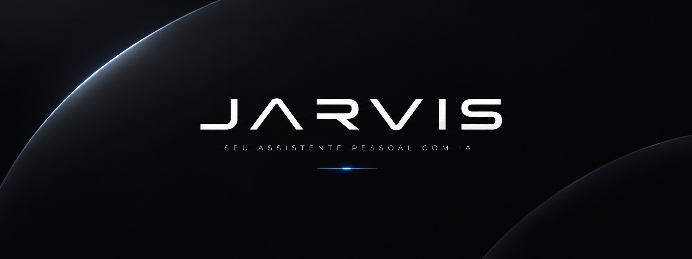

# J.A.R.V.I.S. v2

Assistente pessoal por voz, em português, com o cérebro no **NVIDIA Nemotron**.

## Como iniciar

Dê dois cliques em `iniciar.bat`, ou rode `npm start` no terminal.

Na primeira vez, cole sua chave da API NVIDIA nas configurações (⚙).
Pegue uma chave grátis em https://build.nvidia.com/settings/api-keys (ela começa com `nvapi-`).

## Como usar

- Diga **"Hey Jarvis"** e faça o pedido. Depois da resposta, ele continua ouvindo por 5 s para você seguir a conversa.
- Ou clique no núcleo (orb), aperte **Ctrl+Espaço**, ou digite no chat.
- Clicar no núcleo enquanto ele fala interrompe a resposta.

Exemplos:
- "Toca Numb do Linkin Park" · "Toca minha playlist de sertanejo" · "Coloca um lofi pra programar"
- "Que música é essa?" · "Pula" · "Curte essa" · "Abaixa a música" · "Toca minhas curtidas"
- "Abre o Discord" · "Pesquisa no YouTube vídeos sobre Rust"
- "Abre o campex no VS Code" · "Roda o projeto" · "Como tá o git?" · "O que eu mudei hoje?"
- "Faz commit das mudanças" (ele pergunta "Confirma?") · "Manda pro GitHub" · "Tem PR aberto?"
- "Copiei um erro, me explica" · "Olha esse erro na minha tela"
- "O que tá rodando na porta 8000?" · "Mata o que tá na porta 3000" · "Quais containers estão rodando?"
- "Bom dia" / "Briefing" (ou o botão ☀): dólar, notícias de IA, curiosidades, hoje na história, memes, clima e pendências em cards animados
- "Modo foco de 50 minutos" · "Quanto falta?" · "Para o modo foco"
- "Adiciona na lista: revisar o PR" · "O que tenho pra fazer?" · "Terminei a tarefa do PR"
- "Anota que o deploy precisa da DATABASE_URL" · "O que eu anotei sobre deploy?"
- "Me mostra um gráfico do dólar no último mês" · "Compara Rust e Go numa tabela" · "Mostra o painel do campex"
- "Conecta a câmera do celular" (QR code) · "O que você está vendo?" · "Lê esse texto aqui"
- **Ctrl+Alt+J**: falar com o JARVIS de qualquer programa · **Ctrl+Alt+K**: mostrar/esconder a janela
- Ao minimizar, o JARVIS vira um mini-orb flutuante (clique: falar · duplo clique: abrir · arraste para mover)
- **Celular** (app no navegador, link fixo depois do 1º QR): segurar para falar, música, tarefas, câmera e alertas
- "Vou sair, vigia o quarto" (modo sentinela: alerta com foto no celular e no Telegram) · "Voltei, desliga o sentinela"
- Mostre um rascunho de tela para a câmera: "Transforma esse desenho em código" · "Deixa o botão verde"
- **Telegram**: converse com o JARVIS de qualquer lugar (texto, áudio ou foto) e receba os alertas.
  `/menu` (botões: status, print, música, briefing, tarefas, sentinela, foco, bloquear) · `/status` · `/print`
  (todos os monitores) · `/tarefas` (toque para concluir). Painéis visuais chegam como imagem; confirmações e
  o resultado de cada agente de código vêm com botões (✅ Aplicar / 🗑 Descartar / 📄 Ver diff).
- **🚗 JARVIS Drive** (modo carro do app do celular, botão 🚗 no topo ou o link com `&drive=1`): tela preta, letras
  grandes e quase nada para ler. Toque no microfone e fale; ele para sozinho quando você para de falar e a resposta
  é sempre falada e curta. Blocos: Agenda (próximo lembrete ou tarefa), Música (tocar/pausar, próxima), Rota ("me leva
  para o shopping" → botão grande para Google Maps, Waze ou Apple Maps) e Projetos (o que as agentes estão fazendo).
  Avisos importantes (agentes, lembretes, sentinela) são falados no celular. Funciona fora de casa pelo **Tailscale**:
  o JARVIS também escuta no IP do Tailscale e manda o link do modo carro no Telegram na primeira vez.
- **🎧 Fone pelo celular** (botão 🎧 no topo do app do celular): o som do PC (música, vídeos, a voz do JARVIS) toca
  no celular e no fone Bluetooth conectado nele, para PCs sem Bluetooth. As caixas do PC ficam mudas enquanto isso e
  voltam sozinhas ao parar. "🎙 Microfone do fone" faz o microfone do fone virar o microfone do JARVIS ("Hey Jarvis"
  pelo fone); no iPhone isso passa o fone para o modo ligação (som de qualidade menor), então desligue o microfone
  para ouvir música em alta qualidade. Conexão direta por WebRTC (Wi-Fi ou Tailscale), Opus estéreo. No iPhone,
  deixe a tela do app aberta: o Safari corta o som em segundo plano.
- **App do celular → PC**: tela do PC ao vivo (toque na imagem = clique ali), touchpad (arrastar move,
  toque clica, 2 dedos rolam, segurar = clique direito), mídia, volume, digitar no PC e bloquear
- **🪑 Presença na mesa** (Câmera → 🪑, ou "liga a presença"): com o celular apoiado olhando para você, o MediaPipe
  Pose roda no próprio celular e só manda "presente / postura" para o PC (o vídeo não sai do celular). Levantou por
  mais de 25 s: pausa a música e o pomodoro. Voltou: "Bem-vindo de volta, você ficou 12 minutos fora" e retoma tudo
  (saídas de menos de 1 min voltam em silêncio). Postura curvada por mais de 1 min: avisa (no máximo a cada 15 min;
  calibra nos primeiros segundos, sentado direito). 50 min seguidos sentado: sugere levantar (ajustável: "me lembra de
  levantar a cada 40 minutos"). O painel Sistema da tela inicial mostra "na mesa há 34 min · postura ok".
- **App do celular → Câmera**: 📷 liga/desliga, ⟲ vira, ✋ gestos, 👁 Perguntar ("o que é isso?", "lê o texto")
  e ✏ Desenho → código, com a resposta aparecendo por cima do vídeo
- "Pesquisa a fundo sobre..." (lê várias páginas e gera um relatório com fontes) · "Resume esse link" (link copiado)
- "Compara FastAPI, Flask e Django" (tabela, notas, prós e contras, veredito e dados reais de npm/PyPI/GitHub)
- "Quem foi Nikola Tesla?" (card com foto) · linhas do tempo e passo a passo na tela
- **Codex**: "Jarvis, pede pro Codex criar um site de petshop" → o JARVIS cria a pasta (ou usa o projeto: "no campex,
  pede pro Codex..."), abre no VS Code e o Codex (o da extensão do VS Code, na sua conta) trabalha sozinho; os arquivos
  aparecem no VS Code ao vivo e o JARVIS avisa por voz (e no Telegram) quando ele termina, com um resumo.
  "Agora pede pra ele deixar o botão azul" continua a mesma conversa · "O Codex terminou?" · "Para o Codex".
  O Codex só escreve dentro da pasta do projeto (internet liberada para npm/pip). As conversas aparecem nos Chats do Codex.
- **Oficina** (aba ▦ na barra lateral, ou "abre a oficina no outro monitor" para a janela dedicada): o local de
  trabalho da equipe de agentes de código **F.R.I.D.A.Y.**, **E.D.I.T.H.** e **K.A.R.E.N.** Cada uma tem a sua baia
  com avatar, progresso, o que está fazendo ao vivo, resumo, diff e os botões Aplicar / Ajustar / Descartar.
  "Cria um site de petshop e um site de compra e venda de carros" → duas agentes trabalham ao mesmo tempo.
  "No campex, cria um endpoint de health check" · "Aplica o da Friday" · "Pede pra Edith deixar o tema azul" ·
  "Como estão as agentes?" · ou o botão **＋ Nova tarefa** na própria Oficina
- **🧪 Laboratório**: "Jarvis, tenho uma ideia: um app para dividir a conta do bar" → uma agente monta um protótipo em
  HTML/CSS/JS (sem npm) numa sessão temporária; o navegador abre e recarrega a cada arquivo salvo, então dá para ver o
  protótipo se montando. No fim o JARVIS apresenta em voz alta. "Troca o tema para dourado", "adiciona um botão de
  WhatsApp" → muda ao vivo (pedidos feitos durante a construção entram na fila). "Gostei, salva como projeto" copia para
  a pasta de projetos com git; "encerra o laboratório" apaga a sessão. Também pela Oficina: ＋ Nova tarefa → 🧪 Laboratório.
- "Mostra um holograma do reator arc" (também: Terra, átomo, sistema solar, DNA). Com o modo **✋ Gestos** do celular: pinça clica, pinça+arrastar gira, mão aberta deslizando troca de tela, punho fecha
- Fale por cima do JARVIS para interrompê-lo (melhor com headset)
- "Como está o tempo amanhã?" · "Quais as notícias de hoje?"
- "Quem ganhou o jogo do Palmeiras ontem?" (pesquisa na web)
- "Me lembra de tirar a pizza do forno em 15 minutos"
- "Aumenta o volume" · "Pula a música" · "Tira um print" · "Bloqueia o PC"

## Telas

A barra lateral (ou **Ctrl+1…6**, ou por voz: "abre a tela de música") troca entre:

| Tela | O que tem |
|---|---|
| **Início** | O HUD: orb, painéis de sistema, música, clima e agenda |
| **Música** | Capa com visualizador de áudio, letra sincronizada (LRCLIB; clique numa linha para pular), fila e playlists |
| **Projetos** | Cards dos projetos (git, abrir no VS Code, rodar scripts, painel, pull, GitHub), portas em uso e containers Docker |
| **Agenda** | Kanban (arraste entre A fazer / Fazendo / Feito; duplo clique edita), horas de foco da semana, notas e lembretes |
| **Memória** | Fatos que o JARVIS lembra sobre você (memória de longo prazo), conversas com busca e o que você mais pede |
| **Pesquisas** | Relatórios, comparações e resumos de links salvos, com busca, citações clicáveis e progresso ao vivo |
| **Ajustes** | IA, voz, atalhos, YouTube Music, espaço em disco e funções liga/desliga |

O chat fica sempre à direita, em qualquer tela.

## Arquitetura

| Parte | Arquivo | O que faz |
|---|---|---|
| Electron (main) | `main.js` | Chama o Nemotron com streaming + tool calling, coordena voz, histórico e monitor do sistema |
| Skills | `skills/*.js` | Cada arquivo é uma área (música, sistema, info, lembretes) com ferramentas `{ name, description, parameters, run }`. Para adicionar uma funcionalidade, crie um arquivo |
| YouTube Music | `lib/ytmusic.js` | Controla o YouTube Music Desktop (Pear Desktop) em `E:\Apps\YouTubeMusic` pela API (porta 26538) e pela porta de depuração (9229) |
| Interface | `src/` | `renderer.js`: HUD, chat, áudio, painel holográfico e gráficos · `screens.js` + `screens.css`: as telas · `mini.html`: mini-orb |
| Letras | `lib/lyrics.js` | Busca letras sincronizadas no LRCLIB |
| Memória | `skills/memory.js` | Fatos sobre o usuário (`data/memory.json`) que entram no prompt; conversas em `data/conversations.jsonl` |
| Voz (Python) | `python/voice_service.py` | "Hey Jarvis" → faster-whisper → texto; edge-tts → mp3 |

Enquanto o JARVIS ouve ou fala, a música abaixa para 20% e volta depois.

Ações sensíveis (commit, push, matar processo) declaram `confirm()` na skill. A primeira chamada só
devolve um pedido de confirmação. A execução exige uma nova fala afirmativa do usuário ("sim", "pode")
num turno posterior, então o modelo não consegue se autoconfirmar.

Projetos ficam em `E:\Projetos` (`projectsDir` em `data/config.json`). Para repositórios privados
no GitHub, coloque um token em `githubToken`.

Canais: cada pedido sabe de onde veio (`pc`, `phone`, `telegram`) e a resposta volta pelo mesmo caminho.
Pedidos do celular são falados no celular, e os do Telegram são respondidos em texto. Áudios de fora são
transcritos pelo mesmo Whisper do serviço de voz (comando `transcribe`).

Telegram (`lib/telegram.js`): bot próprio criado no @BotFather, com long polling (sem abrir porta).
Só responde ao chat que mandou o código de pareamento mostrado nos Ajustes.

Sentinela (`skills/sentinel.js`): detecção de movimento local (miniaturas 64×48) e, só quando há
movimento, confirmação pela IA de visão de que é uma pessoa. Fotos em `data/sentinel/`.

Pesquisa (`skills/research.js` + `lib/web.js`): busca no DuckDuckGo, leitura do texto principal das páginas
(respeitando o charset), Wikipédia e dados de pacotes (npm, PyPI, GitHub). A pesquisa profunda planeja consultas,
lê até 14 fontes em paralelo e pede ao modelo um relatório em JSON com citações [n]. Tudo fica em `data/research/`.

Agentes de código (`skills/codeagent.js`): até 3 trabalhos em paralelo, um por agente. Cada um cria um `git worktree`
em `data/worktrees/` numa branch `jarvis/<agente>-...` (projeto novo: pasta com `git init` em projectsDir),
roda um laço de ferramentas (listar, ler, buscar, editar, escrever, rodar comando de verificação) com o modelo
e faz commit na branch; o diff é sempre contra o commit de partida, então os ajustes se acumulam. As chamadas à
API são espaçadas entre as agentes (limite de requisições). "Aplicar" faz merge `--no-ff` no projeto real e remove a cópia. Só comandos de
verificação são permitidos (pytest, py_compile, ruff, node --check, npm test/lint/build, tsc/eslint...).

Controle do PC (`lib/pcinput.js`): um PowerShell fica aberto com uma classe C# (SetCursorPos, mouse_event,
keybd_event, SendKeys); cada comando do celular é uma linha no stdin. A tela vai para o celular a ~2,5 quadros/s
via `desktopCapturer`.

Hologramas e gestos (`src/holo.js` + `src/gestures.js`): Three.js com modelos procedurais; os gestos usam o
MediaPipe Hand Landmarker rodando no celular (`lib/phone/phone.js`), que envia só os 21 pontos da mão.

Conversa natural: enquanto o PC fala, o serviço de voz fica no modo `watch` e, se o usuário falar por ~0,3 s,
emite `barge_in`. A fala passa por uma cadeia de efeitos (filtro, chorus curto, reverb) quando "Efeito de voz
de IA" está ligado.

Modelos: a NVIDIA aposenta modelos com frequência. `postChat` troca automaticamente para a lista de reserva
e, se preciso, para o melhor Nemotron disponível na conta (consultando `/v1/models`).

Desenho → código (`skills/sketch.js`): a IA de visão descreve o rascunho e o Nemotron escreve o HTML.
Os protótipos ficam em `data/sketches/`.

Câmera do celular (`lib/phonecam.js`): o JARVIS sobe um servidor HTTPS só no IP do Wi-Fi (porta 8443),
com certificado autoassinado e um token aleatório no QR code. O celular abre a página no navegador e manda
quadros JPEG por WebSocket (~8/s). Nada é instalado no celular.

Gráficos das respostas visuais usam uma paleta categórica validada para o fundo escuro
(`#1a9cc4 #d95926 #199e70 #c98500 #d55181 #9085e9`, nessa ordem, até 6 séries).

O JARVIS abre o YouTube Music sozinho quando necessário. Se você abrir manualmente, use a flag
`--remote-debugging-port=9229 --remote-debugging-address=127.0.0.1`, senão playlists/álbuns não tocam.

## Reinstalar dependências

```
npm install
python -m venv .venv
.venv\Scripts\pip install faster-whisper sounddevice numpy edge-tts websockets openwakeword
```

## Design system: Obsidiana & Champanhe

Tirado da logo (`src/assets/logo.svg`; só a fita: `src/assets/mark.svg`; ícone: `src/assets/icon.png`).
Todos os tokens ficam em `src/tokens.css` (o app do celular repete os mesmos valores em `lib/phone/phone.css`):
preto profundo e grafite quente nas superfícies, **champanhe** `#e9d6b6` como cor da marca, marfim nos brilhos e
bronze nos detalhes. Âmbar, verde e vermelho são reservados para estados (ocupado, ok, erro). Títulos em Michroma,
texto e números em Rajdhani. Os gráficos usam uma paleta categórica própria, validada para daltonismo no fundo
escuro; o champanhe não entra nela porque tem pouca saturação e "lê como cinza". Para transparências, use
`rgba(var(--accent-rgb), .2)`; no canvas, leia o valor com `getComputedStyle`.

Laboratório (`skills/lab.js` + `lib/labserver.js`): a sessão é um repositório descartável em `data/lab/<id>`, e a agente
trabalha num worktree como nas outras tarefas (com um prompt próprio: só HTML/CSS/JS, bibliotecas por CDN, index.html
primeiro). O servidor escuta só em `127.0.0.1:5180`, serve `/lab/<sessão>/` e injeta um script de recarga ao vivo
(Server-Sent Events) e um selo discreto com o que a agente está fazendo. Sessões não sobrevivem a um reinício do JARVIS.
